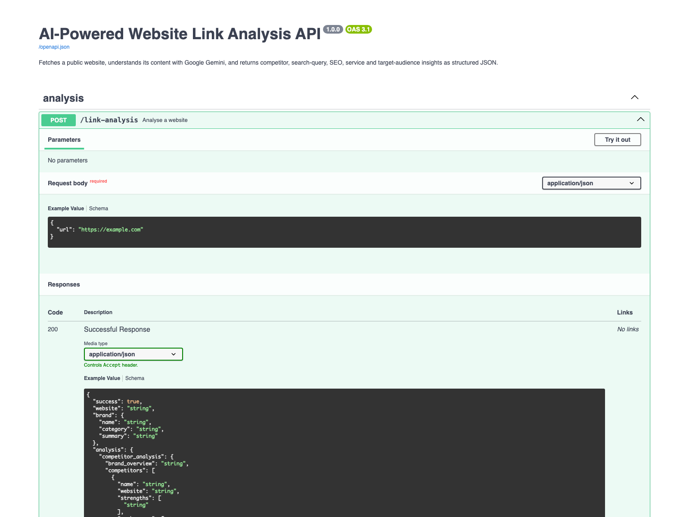
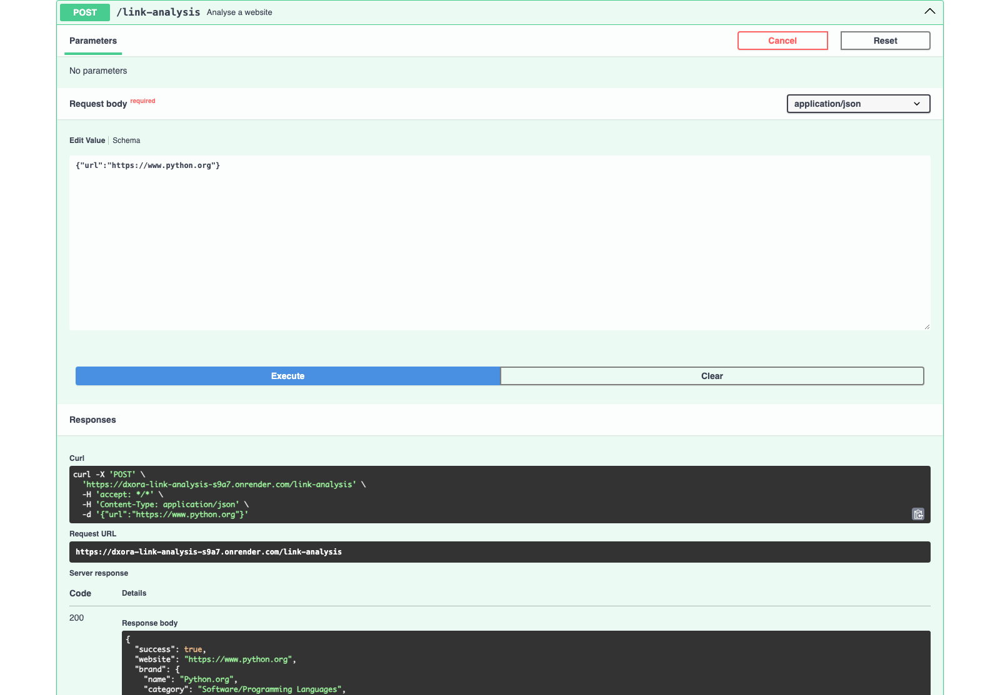
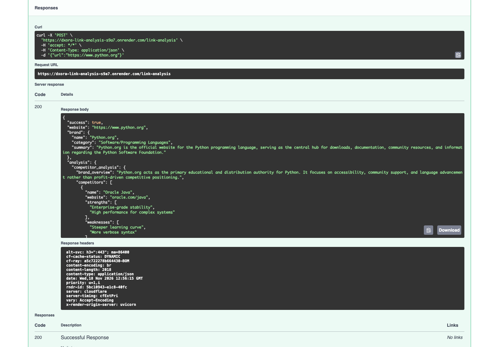

# AI-Powered Website Link Analysis API

FastAPI service that takes a public website URL, extracts its content, sends it to Google Gemini,
and returns structured business intelligence in five sections: competitor comparison, target
search queries, SEO improvements, top services, and target audience.

| | |
| --- | --- |
| **Live demo** | https://dxora-link-analysis-s9a7.onrender.com |
| **API docs** | https://dxora-link-analysis-s9a7.onrender.com/docs |
| **Stack** | Python 3.12+, FastAPI, Pydantic v2, HTTPX, BeautifulSoup, Google Gemini |
| **Assignment** | Dxora Technologies — Python Practical Test (Link Analysis) |

---

## What it does

`POST /link-analysis` with `{"url": "https://example.com"}` returns:

1. **Competitor analysis** — brand name/category/overview, 3–5 real competitors with strengths and
   weaknesses, the brand's advantages, positioning opportunities. Competitors are explicitly
   labelled as AI-generated suggestions.
2. **Top 5 target search queries** — each with the platforms it fits (Google, Facebook, Instagram,
   LinkedIn, X), search intent, business relevance and target audience. **No search volumes are
   invented** — the prompt forbids it and the response schema has no field for them.
3. **SEO improvements** — primary/secondary/long-tail keywords, a recommended title (≤ 60 chars)
   and meta description (≤ 155 chars), plus supporting content ideas.
4. **Top 5 services** — name, description, target industry, target customer, main benefit, and a
   `source` flag (`website` vs `inferred`) so suggestions are clearly separated from facts.
5. **Target audience** — primary/secondary audiences, industries, business types, customer
   profiles, location focus (only when stated), needs, interests and recommended segments.

## How it works

```
POST /link-analysis
  1. validate URL ............ scheme check, DNS resolution, global-IP allowlist (SSRF)
  2. fetch page .............. HTTPX, manual redirect handling (each hop re-validated), 2 MB cap
  3. extract content ......... BeautifulSoup: title, meta description, og:site_name, h1/h2,
                               nav links, deduplicated body text, capped at 12k chars
  4. one LLM call ............ Gemini JSON mode + response_schema (Pydantic model)
  5. validate output ......... Pydantic; on failure one repair call with the validation errors
  6. normalise + respond ..... dedupe competitors, cap at 5, attach disclaimer, return JSON
```

Design choices worth noting:

- **One LLM call for all five sections.** The sections cross-reference each other (SEO keywords
  should reflect the services, queries should reflect the audience). One call is cheaper, faster,
  and more internally consistent than five parallel calls.
- **Schema-constrained output.** `response_schema=LLMOutput` makes Gemini emit JSON matching the
  Pydantic model. Pydantic validation plus a single repair retry is the second layer.
- **Every failure is a structured JSON error**, never an HTML traceback.

## Quick start

```bash
python3 -m venv .venv
source .venv/bin/activate
pip install -r requirements-dev.txt

cp .env.example .env        # then put your Google AI Studio key in GEMINI_API_KEY

pytest -q                   # offline test suite, no API key needed
uvicorn app.main:app --host 0.0.0.0 --port 4000
```

- API: `http://localhost:4000/link-analysis`
- Interactive docs (OpenAPI): `http://localhost:4000/docs`

Get a free key at <https://aistudio.google.com/api-keys>.

## API reference

### Request

```
POST /link-analysis
Content-Type: application/json

{"url": "https://example.com"}
```

### Response `200 OK`

```json
{
  "success": true,
  "website": "https://example.com",
  "brand": {"name": "...", "category": "...", "summary": "..."},
  "analysis": {
    "competitor_analysis": {
      "brand_overview": "...",
      "competitors": [
        {"name": "...", "website": "...", "strengths": ["..."], "weaknesses": ["..."]}
      ],
      "strengths": ["..."],
      "opportunities": ["..."],
      "disclaimer": "Competitor details are AI-generated suggestions ..."
    },
    "target_search_queries": [
      {
        "query": "...",
        "platforms": ["Google", "LinkedIn"],
        "intent": "...",
        "business_relevance": "...",
        "target_audience": "..."
      }
    ],
    "seo_improvements": {
      "primary_keyword": "...",
      "secondary_keywords": ["..."],
      "long_tail_keywords": ["..."],
      "recommended_title": "...",
      "meta_description": "...",
      "supporting_content": ["..."]
    },
    "top_services": [
      {
        "service_name": "...",
        "description": "...",
        "target_industry": "...",
        "target_customer": "...",
        "main_benefit": "...",
        "source": "website"
      }
    ],
    "target_audience": {
      "primary_audience": ["..."],
      "secondary_audience": ["..."],
      "industries": ["..."],
      "business_types": ["..."],
      "customer_profiles": ["..."],
      "location_focus": "...",
      "customer_needs": ["..."],
      "potential_interests": ["..."],
      "recommended_segments": ["..."]
    }
  }
}
```

### Status codes

| Status | `error.code` | Meaning |
| --- | --- | --- |
| 400 | `invalid_url` | Malformed URL, non-HTTP scheme, or a private/internal target (SSRF block) |
| 413 | `payload_too_large` | Request body exceeds 16 KB |
| 422 | `invalid_request` | Body is not JSON or `url` is missing/not a string |
| 502 | `fetch_failed` | Site unreachable, timed out, > 2 MB, not HTML, or no readable text |
| 502 | `llm_failed` | Provider error, timeout, or output still invalid after one repair retry |
| 503 | `llm_not_configured` | `GEMINI_API_KEY` is not set |

All errors use the same shape:

```json
{"success": false, "error": {"code": "invalid_url", "message": "URL points to a private, loopback or reserved address"}}
```

### Sample request

```bash
curl -s -X POST http://localhost:4000/link-analysis \
  -H "Content-Type: application/json" \
  -d '{"url": "https://www.stripe.com"}'
```

**Illustrative response** (trimmed for brevity; real output depends on the page and model):

```json
{
  "success": true,
  "website": "https://stripe.com/",
  "brand": {
    "name": "Stripe",
    "category": "Payment processing / financial infrastructure",
    "summary": "Developer-focused payment platform for online businesses."
  },
  "analysis": {
    "competitor_analysis": {
      "brand_overview": "Stripe provides APIs for accepting payments, billing and financial operations.",
      "competitors": [
        {
          "name": "PayPal",
          "website": "https://www.paypal.com",
          "strengths": ["consumer brand recognition", "one-touch checkout"],
          "weaknesses": ["less developer-centric tooling", "higher dispute friction reported by merchants"]
        }
      ],
      "strengths": ["developer experience and API quality", "broad product breadth (billing, connect, tax)"],
      "opportunities": ["expand case studies for local market segments", "highlight migration tooling"],
      "disclaimer": "Competitor details are AI-generated suggestions derived from the analysed page content and general market knowledge. Verify facts independently before acting on them."
    },
    "target_search_queries": [
      {
        "query": "payment gateway for saas startups",
        "platforms": ["Google", "LinkedIn"],
        "intent": "Commercial investigation",
        "business_relevance": "core product fit",
        "target_audience": "SaaS founders and engineering leads"
      }
    ],
    "seo_improvements": {
      "primary_keyword": "online payment platform",
      "secondary_keywords": ["payment gateway", "subscription billing", "payment API"],
      "long_tail_keywords": ["payment gateway for saas startups", "accept payments internationally developer api"],
      "recommended_title": "Online Payment Platform & APIs | Stripe",
      "meta_description": "Accept payments, manage billing and scale globally with developer-first payment APIs.",
      "supporting_content": ["industry landing pages", "migration guides", "pricing FAQ", "integration tutorials"]
    },
    "top_services": [
      {
        "service_name": "Payments",
        "description": "APIs and hosted checkout for online payment acceptance.",
        "target_industry": "e-commerce and SaaS",
        "target_customer": "online businesses and developers",
        "main_benefit": "faster integration and higher conversion",
        "source": "website"
      }
    ],
    "target_audience": {
      "primary_audience": ["online merchants", "SaaS companies"],
      "secondary_audience": ["marketplaces", "platform businesses"],
      "industries": ["e-commerce", "software", "fintech"],
      "business_types": ["startups", "enterprises"],
      "customer_profiles": ["developers", "finance teams"],
      "location_focus": null,
      "customer_needs": ["reliable payment infrastructure", "global coverage"],
      "potential_interests": ["conversion optimization", "fraud prevention"],
      "recommended_segments": ["SaaS founders", "e-commerce operations leads"]
    }
  }
}
```

## Security

- **SSRF protection** (required by the brief): only `http`/`https`; embedded credentials rejected;
  `localhost`, `*.local`, `*.internal`, `*.home.arpa` and cloud metadata hostnames rejected;
  hostnames are DNS-resolved and every resolved address must be **globally routable** (strict
  allowlist — private, loopback, link-local, multicast, reserved, CGNAT `100.64.0.0/10` and IPv6
  site-local ranges are rejected; IPv4-mapped IPv6 unwrapped first). Redirects are followed
  **manually, max 5 hops, re-validating each hop**, and after connecting the **actual peer IP is
  re-checked**, so a DNS-rebinding swap between validation and connect is rejected too. A public
  URL that redirects to `http://169.254.169.254/` is blocked at both checks.
- **Resource limits**: 15 s total fetch deadline (shared across redirects and slow responses),
  2 MB download cap, 16 KB request-body cap, 12k chars sent to the LLM, 90 s LLM timeout, no
  request-body file uploads. DNS resolution and HTML extraction run in worker threads so they
  cannot block the event loop.
- **Secrets**: `GEMINI_API_KEY` comes from the environment / `.env`; `.env` is git-ignored and
  `.env.example` holds only placeholders. The key never appears in responses or logs.
- **Egress**: environment proxies are ignored (`trust_env=False`), so requests connect directly
  and the peer-IP check reflects the real destination. A deployment that must egress through a
  proxy would need a proxy-aware validation path.

## Tests

`pytest -q` runs fully offline — no network, no API key:

- private IP literals (`127.0.0.1`, `10.0.0.5`, `192.168.1.10`, `169.254.169.254`, `[::1]`, `0.0.0.0`) are rejected
- local/internal hostnames (`localhost`, `*.local`, `*.internal`, metadata) are rejected
- non-HTTP schemes, embedded credentials, missing hostnames are rejected
- `422` for missing `url`, `400` for blocked targets, `502`/`503` mappings for upstream failures
- successful response contains exactly the five analysis sections
- HTML extraction (title, meta description, og:site_name, headings, nav, text) works
- competitor output is deduped, capped at 5, and always carries the disclaimer
- CGNAT (`100.64.0.0/10`), benchmark and IPv6 site-local ranges are rejected
- the connected peer address is rejected when it is private (DNS-rebinding guard)
- request bodies over 16 KB return `413 payload_too_large`
- invalid LLM output is repaired once; still-invalid output raises `llm_failed`

## LLM platform research: cost, speed and accuracy

Prices are USD per 1M tokens, **standard (non-batch) tier**, checked **18 November 2026** against
provider pricing pages (sources at the end). "Structured JSON" means the provider can constrain
output to a schema or JSON mode. This is desk research — **no latency benchmark was run**, so
speed claims are labelled as provider claims or third-party reports, not measurements.

### A. Platform comparison

| Provider | Model | Input $/1M | Output $/1M | Context | Structured JSON | Free tier |
| --- | --- | --- | --- | --- | --- | --- |
| Google | `gemini-3.1-flash-lite` | **$0.25** | **$1.50** | 1,048,576 in / 65,536 out | `response_schema` | Yes (tokens free) |
| Google | `gemini-3.8-flash` | $0.75* | $3.75* | 1M in / 65,536 out | `response_schema` | Yes |
| OpenAI | `gpt-6-luna` | $0.10 | $0.50 | ~1.05M in / 128k out | Structured Outputs | No |
| Anthropic | `claude-haiku-5-5` | $0.10** | $0.50** | 1M in / 128k out | Structured outputs | No |
| Groq | `openai/gpt-oss-120b` | $0.15 | $0.60 | 131,072 | JSON mode | Yes (limits unverified) |

\* Gemini 3.8 Flash is promotional through 31 Dec 2026; **$1.50 / $7.50 from 1 Jan 2027**.
\** Claude Haiku 5.5 is tiered: $0.10 / $0.50 for prompts ≤ 100k tokens, 5× those rates above 100k.

### B. Best model selection

| Criterion | Why it matters here | Winner |
| --- | --- | --- |
| Accuracy on page understanding | All five sections depend on faithful reading of marketing copy | Frontier-tier Flash / small frontier models handle this task reliably |
| Response time | Users wait synchronously per request | Flash-Lite and Haiku classes; Groq is fastest per published throughput |
| Cost per call | See math below; difference is cents, not dollars | GPT-6 Luna, Claude Haiku 5.5 at list price |
| Structured JSON reliability | A malformed response means a retry (double cost) | All four have schema modes; Gemini's schema mode is what this repo uses |
| Large content handling | Marketing pages are 10–100k chars; context is never the bottleneck | Gemini's ~1M-token context gives headroom even without truncation |
| Zero-cost demo | Assignment demo should not require billing setup | Gemini free tier |

### C. Cost optimization (what this repo actually does)

- Sends **extracted text only** — scripts, styles, SVGs, nav boilerplate removed — not raw HTML.
- **Deduplicates lines** and caps input at **12,000 chars** (~3–3.5k tokens for the page).
- **One LLM call** for all five sections instead of five calls; no repeated calls per request.
- **`response_schema`** makes retries rare; the repair retry runs only on validation failure.
- `max_output_tokens` is capped so runaway generations cannot inflate cost.
- `GEMINI_MODEL` is an env var, so a cheaper or stronger model can be swapped without code changes.

Not implemented (deliberate scope choices, all reasonable next steps): response caching keyed by
URL hash with a TTL, batch API for bulk runs (50% discount), and routing "simple" pages to
Flash-Lite while sending heavy pages to Flash.

### D. Final recommendation

| | |
| --- | --- |
| **Provider / model** | Google Gemini `gemini-3.1-flash-lite` |
| **Estimated input** | ~4,500 tokens (instructions + schema ~1,000, page content ~3,000–3,500) |
| **Estimated output** | ~1,800 tokens (formatting overhead included) |
| **Estimated cost per analysis** | **≈ $0.0038 paid tier** (4,500 × $0.25/M + 1,800 × $1.50/M); **$0** on the free tier |
| **Expected response time** | page fetch 0.5–3 s + LLM 3–15 s (estimate, not measured; the server logs end-to-end seconds per request) |
| **Why this model** | Free tier makes the live demo zero-cost; schema-constrained JSON; ~1M-token context means truncation never loses content; fast Flash-Lite class is sufficient for extraction-style analysis |
| **Fallback** | OpenAI `gpt-6-luna` (cheapest at list price, strong Structured Outputs) — swap via `GEMINI_MODEL`-style config if Gemini quota or availability becomes a problem |
| **Balancing approach** | Flash-Lite + one call + heavy content cleaning for routine pages; escalate to `gemini-3.8-flash` for pages where output quality matters more than cost |

**Honest cost note:** at *list price*, `gpt-6-luna` and `claude-haiku-5-5` are cheaper per call
(≈ $0.0014 vs ≈ $0.0038). Gemini wins this assignment on the **free tier**, context size and
schema-JSON integration — not on list price. For production volume, re-evaluate against the table above.

**Speed note:** OpenAI markets a "Fast"/"Ultrafast" service tier (~2×/3–6×), Anthropic labels Haiku
5.5 its fastest model, Groq publishes ~500 tok/s for `gpt-oss-120b`, and a third-party report cites
~218 tok/s for Gemini 3.8 Flash. These are **claims and third-party data, not measurements**;
the repo's log line `Analysis completed for <url> in X.Xs` gives the real number per request.

### Sources

- Google Gemini pricing & rate limits: <https://aistudio.google.com/docs/pricing> (checked 18 Nov 2026)
- OpenAI API pricing: <https://developers.openai.com/api/docs/pricing>
- Anthropic pricing: <https://claude.com/pricing>
- Groq models: <https://console.groq.com/docs/models>

Gemini prices were verified directly on the official page on 18 Nov 2026; the other providers'
figures come from their official pricing pages via the same-day research pass — re-check before
quoting externally.

## Deployment (Render)

`render.yaml` is a Blueprint, so deployment is: push repo → Render → **New → Blueprint** → pick
the repo → enter `GEMINI_API_KEY` when prompted → deploy.

Manual equivalent: new **Web Service** → Python runtime → build `pip install -r requirements.txt`
→ start `uvicorn app.main:app --host 0.0.0.0 --port $PORT` → add `GEMINI_API_KEY` env var.

Notes:

- The free instance sleeps after idle; the first request can take ~50 s to wake.
- Gemini free-tier RPM/RPD limits are no longer published publicly (they are shown per key in
  Google AI Studio) — if the demo throttles under review traffic, attach a billing account;
  at ~$0.004/request that costs cents.

## Project structure

```
app/
├── main.py                     # FastAPI app, single endpoint, error mapping
├── config.py                   # pydantic-settings, env-driven configuration
├── schemas.py                  # request / LLM-output / response models
├── services/
│   ├── website_extractor.py    # SSRF-safe fetch + HTML → text extraction
│   ├── llm_service.py          # Gemini JSON-mode client
│   ├── analysis_service.py     # orchestration: extract → LLM → validate → normalise
│   └── competitor_service.py   # dedupe, cap at 5, disclaimer enforcement
└── utils/
    └── validators.py           # URL validation + SSRF rules
tests/
└── test_link_analysis.py       # offline pytest suite
.env.example · requirements.txt · requirements-dev.txt · render.yaml · README.md
```

## Evidence

All captures come from the deployed service at
<https://dxora-link-analysis-s9a7.onrender.com> (the root redirects to `/docs`).

**Deployed API documentation**



**Live analysis request** — `POST /link-analysis` with
`{"url": "https://www.python.org"}` executed from the deployed Swagger UI:
`200 OK` with all five sections.





**Offline test suite** — 35 tests, no network or API key required:

```
$ pytest -q
...................................                                      [100%]
35 passed, 1 warning in 0.29s
```

The captured response body is saved at
[`evidence/live-response.json`](evidence/live-response.json).

## Submission checklist (per the brief)

- [x] Public GitHub repository with this source
- [x] `README.md` includes setup, sample request/response, LLM comparison and recommendation
- [x] No keys or credentials committed (`.env` is git-ignored)
- [x] Live demo URL + `/docs` reachable

## Limitations

- **Static HTML only.** The page is fetched with HTTPX, not a headless browser, so client-side
  rendered (SPA) sites may yield little text; those return `fetch_failed` rather than a hallucinated
  analysis when under 200 readable characters.
- Competitor data is AI-generated suggestion, labelled as such in the response.
- No response caching yet; each request costs one LLM call (fractions of a cent on Flash-Lite).
